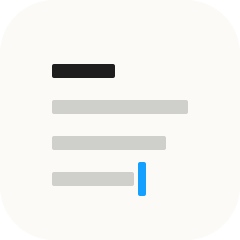
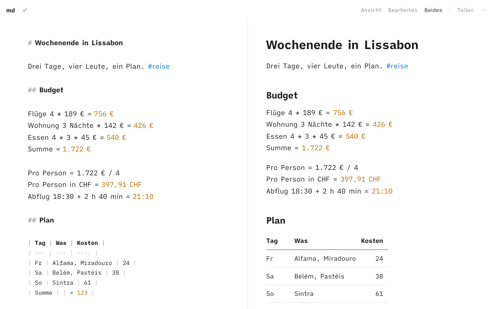
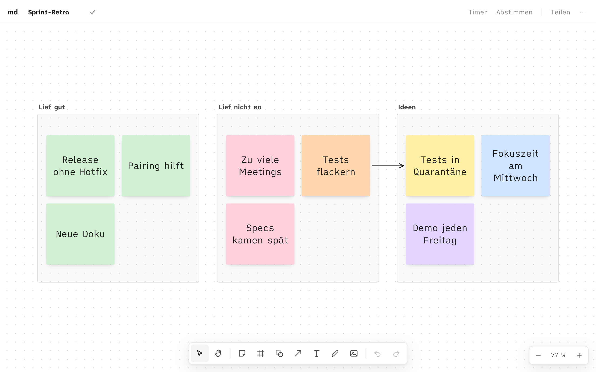
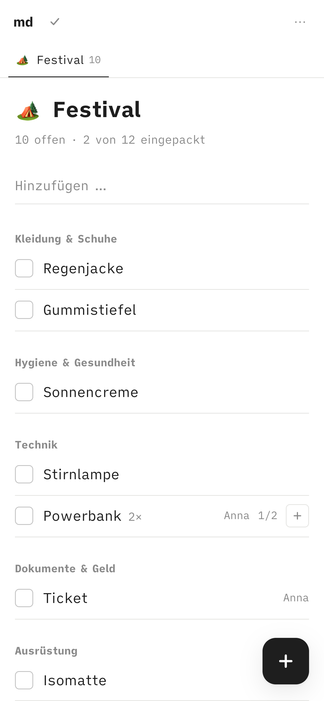
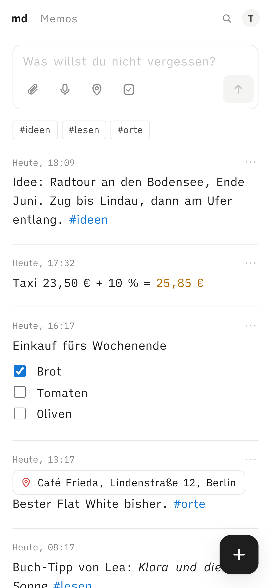

<p align="center">
  
</p>

<h1 align="center">md</h1>

<p align="center">
  <strong>Aufmachen, schreiben, Link schicken.</strong><br>
  Markdown-Dokumente, Whiteboards und Packlisten im Browser.<br>
  Ohne Konto, ohne Installation, gemeinsam in Echtzeit.
</p>

<p align="center">
  <a href="https://md.veerka.mp"><strong>md.veerka.mp öffnen →</strong></a>
</p>

<br>

<picture>
  <source media="(prefers-color-scheme: dark)" srcset="docs/bilder/editor-dark.png">
  
</picture>

## Warum md

**Kein Anfang, der dich aufhält.** md.veerka.mp öffnen und tippen. Das Dokument
entsteht mit dem ersten Buchstaben und speichert sich selbst. Es gibt keinen
Speichern-Knopf, keine Ordner und keine Anmeldung.

**Ein Link zum Lesen, einer zum Mitschreiben.** Den Leselink kannst du überall
hinschicken. Wer den Bearbeiten-Link hat, schreibt mit, und alle sehen die
Cursor der anderen live. Für das Handy gibt es beide Links auch als QR-Code.

**Rechnet mit.** Endet eine Zeile auf `=`, steht das Ergebnis dahinter. Das
klappt mit Variablen, Prozent, Einheiten, Uhrzeiten und Währungen zu
EZB-Tageskursen. `Summe =` addiert die Zeilen darüber, in Tabellen auch ganze
Spalten.

**Liest sich schön.** Gesetzt in iA Writer Quattro, hell oder dunkel, und auch
als PDF sauber gedruckt. Formeln, Mermaid-Diagramme, Codeblöcke mit Farben,
Hinweisboxen und Inhaltsverzeichnis sind dabei.

**Funktioniert auch offline.** md lässt sich als App installieren. Was du
offline schreibst, gleicht sich beim nächsten Verbinden ab.

**Bleibt privat.** Es gibt kein Tracking, keine Werbung und keine
Suchmaschinen-Indizierung. Dokumente haben zufällige Adressen, die niemand
errät. Was zwölf Monate keiner öffnet, wird gelöscht.

## Rechnen wie auf Papier

```text
Flüge 4 * 189 € =             756 €
Wohnung 3 Nächte * 142 € =    426 €
Essen 4 * 3 * 45 € =          540 €
Summe =                     1.722 €

Pro Person = 1.722 € / 4
Pro Person in CHF =        397,91 CHF
Abflug 18:30 + 2 h 40 min =     21:10
```

Die Ergebnisse stehen nur auf dem Bildschirm, im Text bleiben die Zeilen
unverändert. Zahlen dürfen deutsch (`1.250,50`) oder schweizerisch
(`1'250.50`) geschrieben sein.

## Whiteboards

Notizen, Bereiche, Formen, Pfeile, Stift und Bilder auf einer unendlichen
Fläche. Für Retros und Workshops gibt es einen Timer für alle, Abstimmen mit
Punkten (verdeckt bis zum Schluss) und „Alle zu mir holen“, damit alle
dasselbe sehen. Jedes Board lässt sich auch als Markdown abrufen.

<picture>
  <source media="(prefers-color-scheme: dark)" srcset="docs/bilder/board-dark.png">
  
</picture>

## Packlisten und Memos

<table>
  <tr>
    <td width="50%" valign="top">
      <picture>
        <source media="(prefers-color-scheme: dark)" srcset="docs/bilder/pack-dark.png">
        
      </picture>
    </td>
    <td width="50%" valign="top">
      <picture>
        <source media="(prefers-color-scheme: dark)" srcset="docs/bilder/memos-dark.png">
        
      </picture>
    </td>
  </tr>
  <tr>
    <td valign="top">
      <strong>Packlisten</strong> sortieren sich selbst in Kategorien. „3x Isomatte“
      setzt die Menge. Pro Artikel legst du fest, ob ihn jede Person braucht oder
      ob er einmal für alle reicht. Abhaken heißt „ich hab’s eingepackt“, und
      alle sehen, wer was mitbringt.
    </td>
    <td valign="top">
      <strong>Memos</strong> sind private Kurznotizen mit Google-Konto: Gedanken,
      Aufgaben, Fotos, Sprachmemos und Orte, sortiert nach Tags. Aus jedem Memo
      wird auf Wunsch ein teilbares Dokument.
    </td>
  </tr>
</table>

## Für KI-Agenten

Sag einem Agenten „veröffentliche das auf md.veerka.mp“. Er findet dort die
Anleitung ([/llms.txt](https://md.veerka.mp/llms.txt)), legt das Dokument mit
einer Anfrage an und antwortet mit dem Bearbeiten-Link. Ohne Schlüssel gehen
20 Dokumente am Tag. Chat-Assistenten, die keine Anfragen schicken können,
geben stattdessen einen Link `md.veerka.mp/#text=…` aus. Ein Klick darauf legt
das Dokument an.

```bash
curl https://md.veerka.mp/api/docs -H "Content-Type: text/markdown" --data-binary @bericht.md

curl https://md.veerka.mp/<adresse>.md
```

Mit API-Schlüssel gibt es keine Grenze und eigene Adressen (`?id=…`).

## Selbst betreiben

md läuft komplett auf Cloudflare: ein Worker, ein Durable Object pro Dokument
(SQLite und WebSockets) und R2 für Bilder.

```bash
git clone https://github.com/Savo2610/md.git && cd md
npm install
npm run dev          # http://localhost:8790
```

Für eine eigene Instanz passt du in `wrangler.jsonc` Domains, R2-Bucket und
Turnstile an und nimmst das Service-Binding `FUNK` heraus (es gehört zu einem
anderen Projekt). Die Weiterleitungen der Domains stehen in
`src/worker/index.ts`. Danach setzt du die Secrets mit
`npx wrangler secret put` und deployst mit `npm run deploy`. Welche Secrets es
gibt, wie der Google-Login eingerichtet wird und wie alles zusammenhängt, steht
im [Handbuch](docs/handbuch.md).

**Gebaut mit** CodeMirror 6, Yjs, markdown-it, KaTeX, Mermaid und TypeScript.
Die Ansicht wird auf dem Server gerendert, schwere Bibliotheken lädt der
Browser erst, wenn ein Dokument sie braucht.

## Lizenz

Der Code steht unter der [MIT-Lizenz](LICENSE). Die Schriften iA Writer
Quattro und Mono stehen unter der [SIL Open Font License](public/fonts/LICENSE-iA-Fonts.md).
